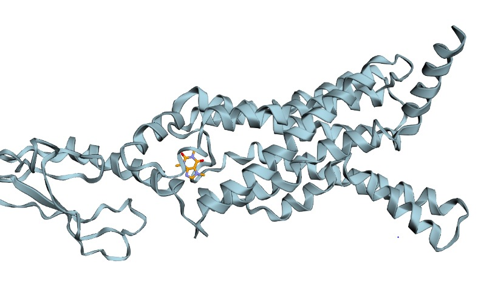
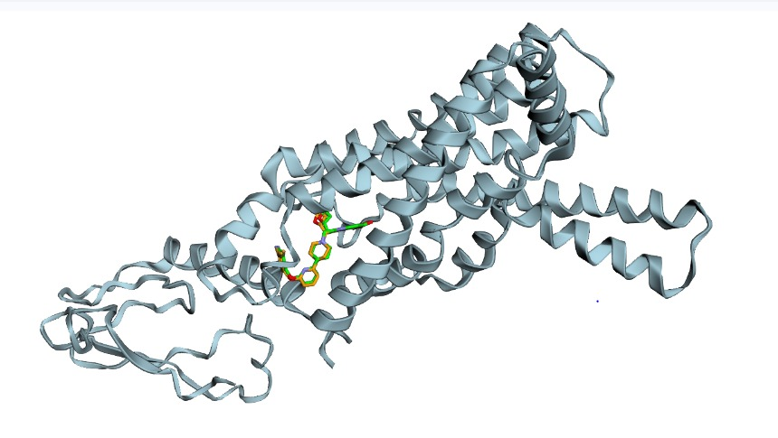

# Molecular Docking with AutoDock Vina: GLP-1 Receptor

Dock caffeine as a practice ligand, and re-dock danuglipron into its own GLP-1R pocket, using AutoDock Vina 1.2.5 in Google Colab.

Author: Masood Ur Rehman, MSc Drug Discovery and Development, Uppsala University

## Receptor
- RCSB PDB **7LCJ**: PF 06882961 (danuglipron) bound to human GLP-1R:Gs complex
- Chain R, 408 residues in the parsed file
- Bound ligand code: UK4 (danuglipron)
- Cleaned receptor: 3,206 protein lines, saved as receptor_clean.pdb
- Bound ligand: 41 lines, saved as bound_ligand.pdb
- Binding pocket centre from the bound ligand: x 125.448, y 157.137, z 113.229
- Box size: 20 x 20 x 20 angstrom, exhaustiveness 8, 5 poses

## Method
- Ligands prepared from SMILES with RDKit: 3D conformer, energy minimisation, PDBQT with Meeko
- Receptor prepared with OpenBabel, then cleaned to ATOM/HETATM/TER lines only for Vina (OpenBabel's ROOT tag was rejected by Vina)
- Docking with the standalone AutoDock Vina 1.2.5 binary in Colab. The Python vina package did not build on Colab Python 3.13, so the binary was used instead.
- Meeko first needed `gemmi` installed separately. OpenBabel needed a separate install after the Vina install failed.

## Results
Scores are Vina docking scores in kcal/mol. They are NOT measured binding affinities, NOT IC50 values, and NOT proof of activity.

| Ligand | Pose | Score (kcal/mol) |
|---|---|---|
| Caffeine (practice) | 1 | -6.226 |
| Caffeine (practice) | 2 | -6.187 |
| Caffeine (practice) | 3 | -6.146 |
| Caffeine (practice) | 4 | -6.054 |
| Caffeine (practice) | 5 | -5.905 |
| Danuglipron (re-docking) | 1 | -12.89 |
| Danuglipron (re-docking) | 2 | -12.63 |
| Danuglipron (re-docking) | 3 | -11.69 |
| Danuglipron (re-docking) | 4 | -10.73 |
| Danuglipron (re-docking) | 5 | -9.303 |

Danuglipron formula: C31H30FN5O4, 71 atoms including hydrogens, 41 heavy atoms. Source: PubChem.

## Images

### Caffeine best pose inside the GLP-1R pocket

Light blue = GLP-1R receptor, orange = caffeine best pose, sitting inside the pocket.

### Danuglipron re-docking overlay

Green = original danuglipron from the crystal structure, orange = redocked danuglipron. They overlap in the same pocket.

## Validation and honest limitations
- Re-docking: danuglipron was docked back into its own 7LCJ pocket. The best score was -12.89 kcal/mol, much stronger than caffeine at -6.226 kcal/mol.
- No RMSD number is reported, on purpose. The original bound ligand had 41 atoms and the redocked pose had 42 atoms, so a simple RMSD calculation with matching atom order would have been misleading. Instead, the visual overlay above was used: green and orange overlap in the same pocket.
- Docking uses a rigid receptor in this workflow, so protein movement is not modelled.
- A docking score does not prove a compound is active, is a drug, or works in real life. Activity needs experiments.
- Caffeine is a practice ligand only. It is NOT a GLP-1R drug, and its score must not be presented as a GLP-1R result.

## Files
- glp1r_docking.ipynb: full Colab workflow, all stages in one notebook, including the fixes above
- docking_results.csv: all pose scores
- caffeine_pose_clean.jpg: viewer image, clean, caffeine pose
- danuglipron_overlay_clean.jpg: viewer image, clean, re-docking overlay
- Project4_Docking_Guide_Book.pdf: step-by-step guide book
- stage1 to stage5 notebooks: staged versions of the same workflow

## Tools
Python, RDKit, Meeko, OpenBabel, AutoDock Vina 1.2.5, py3Dmol, Google Colab

Educational project. Docking is a screening and learning step, not proof of drug activity.
